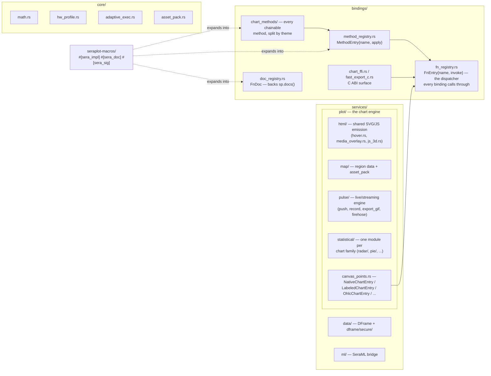

# SeraPlot Architecture

This document describes how this repository is actually laid out today, verified against the
code rather than written from memory. Where something is messy or inconsistent, that is called
out explicitly rather than glossed over — see [Known inconsistencies](#known-inconsistencies).

## 1. What SeraPlot is

SeraPlot is a Rust chart-rendering engine. A chart is built from data, rendered once into a
self-contained HTML/SVG (2D) or HTML/Canvas+WebGL (3D) string, and that string is then handed to
whichever language binding asked for it (Python, JavaScript/WASM, C, C++, C#). This crate is the
single source of truth; every binding is a thin wrapper around the same `Chart` type and the same
method/function registries.

## 2. Repository layout (this checkout)

```
./                     crate root
├── Cargo.toml          package manifest; [lib] path = "lib.rs"
├── lib.rs              crate root — where active development happens
├── core/                math, hardware-profile detection, adaptive execution, asset-pack compressor
├── services/
│   ├── data/            the DFrame data layer (+ services/data/dframe/secure/, encrypted-at-rest)
│   ├── ml/               SeraML bridge code
│   └── plot/             the chart engine itself (see §4)
├── bindings/             every language-binding entry point and the registry/macro system (see §5)
├── seraplot-macros/      proc-macro crate (#[sera_impl], #[sera_doc], #[sera_sig], ...)
├── python/ docs/ wiki/ viewer/ webapp/   bindings & docs generation
└── tools/                dev scripts, CI helpers
```

This checkout also happens to live, locally, nested inside a larger personal workspace that holds
an extended Cargo workspace (`../`, i.e. `v2/`, which compiles this same `lib.rs` to additionally
package npm/C++/C# distributables around it) and sibling products (a VS Code extension, the
SeraML framework, a Power BI connector) that are separate checkouts with their own history. None
of that surrounding workspace is part of *this* repository — if you're reading this file from
GitHub, you're already looking at the repository root; `ARCHITECTURE.md` and `CONTRIBUTING.md`
belong here and nowhere else, specifically so GitHub renders them as the project's root docs
rather than as dead weight in an unrelated local wrapper folder.

**Any new Cargo dependency used from the surrounding `v2/` workspace manifest must also be added
here** — the two manifests don't share a lockfile and nothing enforces that they stay in sync
(tracked in the issue tracker).

## 3. The published surface

| Binding | Mechanism | Entry point |
|---|---|---|
| Python | PyO3, built with `maturin` | `_py.rs`, `#[pymethods]` generated by `#[sera_impl]` |
| JavaScript / WASM | `wasm-bindgen`, built with `wasm-pack` | `services/plot/wasm_export.rs`, feature `js` |
| C / C++ | cbindgen-style FFI | `bindings/chart_ffi.rs`, `bindings/fast_export_c.rs`, feature `ffi` |
| C# / NuGet | P/Invoke over the C FFI | packaged from the surrounding workspace's `csharp/` dir |

All four bindings funnel chart-method calls through the **same** generic dispatcher
(`bindings/fn_registry.rs::invoke`) rather than each reimplementing method dispatch — see §5.

## 4. Module map



| Path | Role |
|---|---|
| `core/` | math, hardware-profile detection, adaptive execution, the asset-pack compressor |
| `services/data/` | the DFrame data layer (+ `services/data/dframe/secure/`, encrypted-at-rest) |
| `services/ml/` | SeraML bridge code |
| `services/plot/html/` | shared HTML/SVG/JS emission helpers (`hover.rs`, `media_overlay.rs`, `js_3d.rs`, ...) |
| `services/plot/map/` | region/world-map data, the generic `asset_pack` region compressor |
| `services/plot/pulse/` | the live/streaming engine (push/push_vector/record/export_gif/firehose/...) |
| `services/plot/statistical/` | per-family 2D/3D renderers (one module per chart family, e.g. `radar/`, `pie/`, ...) |
| `services/plot/canvas_points.rs` | `NativeChartEntry` / `LabeledChartEntry` / `OhlcChartEntry` / `HierarchyChartEntry` / `SeriesChartEntry` — inventory-collected structs describing each "native fast path" chart family (see §5) |
| `bindings/chart_methods/` | every chainable `Chart` method (`.title()`, `.flip()`, `.mask_circle()`, ...), split by theme: `methods.rs`, `apply.rs`, `compose.rs`, `interactive.rs`, `layout.rs`, `extras.rs`, `pages.rs`, `js.rs` (shared JS string constants) |
| `bindings/method_registry.rs` | `MethodEntry { name, apply: fn(&Chart, &str) -> Chart }` — inventory-collected |
| `bindings/fn_registry.rs` | `FnEntry { name, input, output, invoke }` — the generic alias-resolving dispatcher every language binding calls through |
| `bindings/doc_registry.rs` | `FnDoc` — the structured doc entries that back every docs page and `sp.docs()` |
| `bindings/alias_registry.rs`, `name_norm.rs` | alias resolution shared by every registry above |
| `bindings/chart_ffi.rs`, `fast_export_c.rs` | C ABI surface |
| `seraplot-macros/` | the proc-macro crate: `#[sera_impl]`, `#[sera_doc]`, `#[sera_sig]`, `#[sera_doc_impl]` |

## 5. The registry/macro system

This is the one piece of architecture every contributor needs internalised before touching a
chart method.

A chainable method is written **once**, inside an `impl Chart` block annotated `#[sera_impl]`,
with each method carrying `#[sera_doc(category = "chart_method", ...)]` and `#[sera_sig(...)]`:

```rust
#[sera_impl]
impl Chart {
    #[sera_doc(
        category = "chart_method",
        file = "charts/chart.md",
        en = "…", fr = "…",
        param(name = "text", ty = "str", en = "…", fr = "…")
    )]
    #[sera_sig(text)]
    pub fn title(&self, text: &str) -> Chart { /* … */ }
}
```

That single annotation expands, at compile time, into three things registered via
[`inventory`](https://docs.rs/inventory) (no central list to edit by hand):

1. a `doc_registry::FnDoc` entry — surfaced through `sp.docs()` and every chart-methods doc page,
2. a `#[pyo3(name = "...")]` wrapper so Python sees the method directly,
3. a `method_registry::MethodEntry` closure, so the method can also be applied **by name** from a
   string (used when a chart-method is passed as a *constructor kwarg*, e.g.
   `sp.bar(..., flip=True)` instead of `sp.bar(...).flip()`).

```mermaid
flowchart TD
    src["pub fn title(&self, text: &str) -> Chart { ... }\nannotated #[sera_impl] / #[sera_doc] / #[sera_sig]"]
    src -- "compile-time macro expansion" --> doc["doc_registry::FnDoc\n(sp.docs(), doc pages)"]
    src -- "compile-time macro expansion" --> pym["#[pyo3(name=\"title\")]\n(direct Python method)"]
    src -- "compile-time macro expansion" --> mreg["method_registry::MethodEntry\n{name: \"title\", apply: fn}"]

    mreg --> fnreg["fn_registry::invoke\nthe one dispatcher every binding calls"]
    pyB["Python binding"] --> fnreg
    wasmB["WASM binding"] --> fnreg
    cB["C / C++ FFI"] --> fnreg
    csB["C# / NuGet"] --> fnreg
    fnreg -- "resolves aliases, applies\nmethod kwargs, incl. native\nfast-path charts" --> chart["Chart.html"]
```

`bindings/fn_registry.rs::invoke` is the single generic entry point every binding (Python, WASM,
C FFI, C#) calls through. It resolves aliases, decides whether the call matches a chart
constructor or a chart method, and — critically — **always** applies any chart-method keyword
arguments found in the call, including on the nine "native fast path" chart families (the ones
registered in `services/plot/canvas_points.rs` as `NativeChartEntry` / `LabeledChartEntry` /
`OhlcChartEntry` / `HierarchyChartEntry` / `SeriesChartEntry`, which historically bypassed this —
see `bindings/fn_registry.rs::apply_method_kwargs`).

**Consequence for contributors:** never hand-write a second dispatch path for a new chart method.
Add the method to the right file under `bindings/chart_methods/`, annotate it, and every binding
in every language gets it automatically. Grep `fn_registry.rs`/`method_registry.rs` before adding
anything that looks like dispatch logic — it almost certainly already exists.

## 6. Three different rendering architectures — know which one you're editing

A method that patches the generated HTML (`title()`, `mask_circle()`, `color_hex()`, ...) has to
branch on which of three fundamentally different output shapes it's looking at:

```mermaid
flowchart LR
    subgraph twoD["2D — plain SVG"]
        svg["&lt;svg&gt;...&lt;/svg&gt;\ndata-sp=\"l,t,w,h\"\nclass=\"sp-ttl/sp-xl/sp-yl\"\ndata-series / data-idx"]
    end
    subgraph threeD["3D — canvas + WebGL"]
        div3d["&lt;div class=\"c3w\"&gt;\n&lt;canvas&gt;...&lt;/canvas&gt;\n&lt;script&gt; IIFE (js_3d.rs)"]
        hook["window['__sp3dCfg_'+cid]\n(opts) => { ... wake() }"]
        div3d --> hook
    end
    subgraph joint["joint — composite"]
        grid["&lt;div class=\"sp-joint-grid\"&gt;"]
        f1["&lt;iframe srcdoc=...&gt;\nmain scatter panel"]
        f2["&lt;iframe srcdoc=...&gt;\nmarginal histogram"]
        f3["&lt;iframe srcdoc=...&gt;\nmarginal histogram"]
        grid --> f1
        grid --> f2
        grid --> f3
    end

    method["a chart_method call,\ne.g. title()/mask_circle()"] -. "string-search + patch" .-> svg
    method -. "apply_3d_cfg(...)\ncalls the hook" .-> hook
    method -. "CSS on .sp-joint-grid\n(no per-chart id needed)" .-> grid
```

1. **2D charts** — a plain `<svg>…</svg>` tree. Most helpers in
   `bindings/chart_methods/apply.rs` work by string-searching for conventions the renderers
   *usually* but not *always* follow: a `data-sp="l,t,w,h"` attribute giving the plot rectangle,
   `class="sp-ttl"/"sp-xl"/"sp-yl"` on label text nodes, and `data-series="N"` or `data-idx="N"`
   on colored elements. Several renderers don't emit one or more of these, which is why `apply.rs`
   carries multiple fallback tiers for `title`/`x_label`/`y_label`/`color_hex` rather than a single
   lookup — read that file's fallback chains before assuming a method "doesn't work" on some
   family.
2. **3D charts** — zero `<svg>`. A `<div class="c3w">` wraps a `<canvas>`, driven by a per-chart
   inline `<script>` IIFE generated by `services/plot/html/js_3d.rs` (a single very large shared
   renderer, not one file per 3D family). Every 3D chart exposes a runtime hook,
   `window['__sp3dCfg_' + cid] = function(opts) { … }`, which is how chart methods reach into an
   already-rendered 3D chart (`crate::apply_3d_cfg` in `lib.rs` builds the `<script>` snippet that
   calls it). Methods that only need pure CSS on the wrapper (masks, backgrounds) use
   `apply_3d_wrapper_css` instead and never touch the JS hook.
3. **`joint` (the scatter + marginal histograms composite)** — neither of the above. It's a CSS
   grid (`<div class="sp-joint-grid">`) of `<iframe srcdoc="…">` cells, each an entirely
   independent, self-contained chart document. There is exactly one `sp-joint-grid` per `Chart`
   document (confirmed: `hstack`/`vstack` always wrap a sub-chart in its own iframe rather than
   merging documents), so chart methods target it with a bare CSS class selector — no per-chart
   id is needed the way 3D's `cid` is.

**A recurring bug class worth knowing before it bites again:** several chart constructors
auto-apply a chart method's own effect at build time as part of a sensible default (the built-in
legend most charts show, the colorbar `scene="terrain"` 3D charts add automatically, ...). More
than one of those methods used to detect "its own effect is already present" and silently no-op
when called again explicitly — which is wrong whenever the explicit call is trying to *change*
something (reposition the legend, move the colorbar), not just redundantly re-apply it. The fix,
each time, has been the same: replace the existing injected element instead of skipping. If you
add a chart_method with an "already applied?" guard, make sure it replaces rather than skips.

## 7. Build & test

```bash
# Rust unit tests — MUST pass --features python, or every #[sera_impl] registry is empty
# (default features = ["gui", "sysmon", "telemetry-http"], not "python")
cargo test --lib --features python

# Python binding, installed into the surrounding workspace's .venv
maturin develop            # debug, fast
maturin develop --release  # optimized, ~7-8 min from clean

# WASM/JS binding
wasm-pack build --target web --out-dir pkg --features js

# full-suite Rust run (map pack checks, FFI, etc.)
cargo test --features js,ffi
```

Rebuilding is per-binding: a Rust change needs the matching rebuild step above before it is
visible from that language (the Python extension does not pick up Rust changes until
`maturin develop` runs again; same for the WASM bundle and `wasm-pack`).

## 8. Known inconsistencies

Documented here rather than hidden, so nobody mistakes stale code for the real thing, or wastes
time chasing a process gap that's actually already tracked:

- **The surrounding `v2/` workspace manifest compiles this exact same `lib.rs`** as a second,
  independent Cargo manifest with no shared lockfile — dependency drift between the two is a real,
  already-hit failure mode, not a hypothetical one.
- **PyPI currently only carries a single wheel** (`cp311-cp311-win_amd64`) for the latest release,
  despite `pyproject.toml` declaring `requires-python = ">=3.8"` and the CI release workflow
  (`.github/workflows/release.yml`) building Linux and macOS wheels on every tagged release —
  those wheels are attached to the GitHub Release but never uploaded to PyPI, and the workflow has
  no PyPI-publish step at all. The actually-published PyPI version (`2.8.7.post1`) also isn't tied
  to any git tag, meaning it was published by hand outside this pipeline. Tracked in the issue
  tracker along with the npm/NuGet version drift this has also caused.
- **`maps.spak`** (the compiled map region pack under `services/plot/map/`) can go stale relative
  to its source SVGs; `regions::pack::every_pack_entry_matches_its_source_svg_file_byte_for_byte`
  catches this but needs the pack-regenerate step run manually when it fails — it is not
  automatic.
