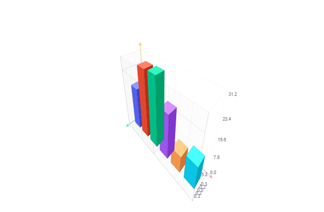

# Sera Pulse

<div class="lang-en">

Sera Pulse is the streaming layer on top of every native chart: `.push()`, `.push_vector()`, `.serve()`, `.record()`, `.replay()`, `.on_anomaly()`. It's free, open-source, no trial, no license, no activation — same as the chart rendering itself.

```python
import seraplot as sp

chart = sp.scatter("Live feed", x=[], y=[])
chart.serve(port=8787)
chart.push([0, 1, 2], [1.2, 3.4, 2.1])
```

---

## What's included

- **Streaming** — `push()`, `push_vector()`, `serve()`, `record()`/`replay()`, `on_anomaly()`, `export_standalone()`.
- **Sera Secure** — `SecureDFrame`, AES-256-GCM encryption at rest, plaintext never cached or logged.
- **Sera Firehose** — `sp.firehose(...)` + `firehose_push()`, a ring-buffered chart for very high-frequency streams, rendered through WebGL2.
- **Sera Live** — live cursors, pinned comments, shared replay on any `.serve()`'d chart.
- **Sera Board** — `serve_board()`/`export_board_html()`, a Figma-style infinite whiteboard of live, linked charts.
- **SeraReport** — `export_pdf()`, `export_docx()`, `export_pdf_report()`.
- **SeraStudio** — `export_gif()`, `export_video()`, session recording/replay for shareable chart clips.

---

## Sera Secure

`SecureDFrame` is the AES-256-GCM encrypted-at-rest counterpart to `SeraDFrame` — columns stay ciphertext in memory, decrypted only transiently for a single read or chart render:

```python
import seraplot as sp

key = sp.SeraKey.generate()
frame = sp.SecureDFrame({"x": x_values, "y": y_values}, key.to_bytes())
chart_data = frame.to_chart_data("x", "y", key.to_bytes(), max_points=2000)
```

`decrypt()`/`decrypt_column()` give back plaintext on demand; `to_chart_data()`/`to_chart_data_multi()` decrypt, downsample, and hand off chart-ready arrays in one step, without ever materializing a decrypted copy of the rest of the frame.

---

## SeraReport

```python
chart = sp.bar("Sales", labels=["Q1", "Q2", "Q3"], values=[120, 150, 90])
chart.export_pdf("sales.pdf")
chart.export_docx("sales.docx")
```

Direct SVG-to-PDF/DOCX, no headless browser. `export_pdf_report(charts, path, titles=None)` combines several charts into one multi-page PDF. Needs real SVG content — charts large enough to cross their native canvas-rendering threshold render via `<canvas>` instead (same boundary `export_svg()`/`export_png()` have). `interactive=True` (default) also writes a companion `.html` with a clickable link back to the live chart.

<div class="sp-video-card" style="max-width:640px">
<iframe src="../previews/serareport-sample.pdf" style="width:100%;height:420px;border:1px solid var(--theme-popup-border, rgba(0,0,0,.2));border-radius:8px"></iframe>
<p><a href="../previews/serareport-sample.pdf" target="_blank" rel="noopener">Open in a new tab</a> if your browser doesn't preview PDFs inline.</p>
</div>

---

## Sera Firehose

A fixed-size ring buffer chart for absorbing very fast streams — sensor ticks, prices, request latencies — without the tab choking on it. Once full, each new reading overwrites the oldest one:

```python
chart = sp.firehose("CPU %", capacity=2_000, min_val=0.0, max_val=100.0)
chart.serve(port=8787)
for reading in sensor_stream():
    chart.firehose_push([reading])
```

Same rate limiting, `on_anomaly()`, `record()`/`replay()`, `.serve()` broadcast as every other native chart — rendered through WebGL2 instead of `<canvas>`, so per-point cost stays flat no matter how many readings landed since the last frame.

<div class="sp-video-card" style="max-width:640px">
<iframe src="../previews/firehose-demo.html" style="width:100%;height:300px;border:1px solid var(--theme-popup-border, rgba(0,0,0,.2));border-radius:8px;background:#fff"></iframe>
<p><a href="../previews/firehose-demo.html" target="_blank" rel="noopener">Open standalone</a> to see it full-size.</p>
</div>

---

## Sera Live

Turns any `.serve()`'d chart into a shared room — everyone who opens the link sees live cursors, can pin a note or draw directly on the chart, and **Replay together** steps the whole room through a recording in lockstep:

```python
chart = sp.bar("Error rate by region", labels=["us-east", "eu-west", "ap-south"], values=[12, 4, 31])
chart.record("incident.spls")
chart.serve(port=8787)
```

Pins are real `bookmark()` annotations — list them later with `chart.bookmarks()`. `collab=False` turns off presence entirely, nothing about you leaves your machine.

---

## Sera Board

Puts several charts on one infinite, pannable canvas instead of five browser tabs — a sidebar lists them, each sits in its own draggable frame:

```python
errors = sp.bar("Error rate", labels=["us-east", "eu-west", "ap-south"], values=[12, 4, 31])
latency = sp.line("p99 latency (ms)", x=list(range(10)), y=[120, 118, 125, 400, 410, 190, 130, 128, 126, 124])
sp.serve_board([errors, latency], titles=["Errors", "Latency"], session="incident-01", port=8787)
```

`serve_board()` joins Sera Board to Sera Live — shared cursors, pins, and drawings stick to each chart's own frame and move with it. A named **session** persists layout/pins/drawings to disk between runs. `export_board_html()` writes the same board as one self-contained file, no server required.

---

## SeraStudio

Renders a `.spls` recording as a shareable GIF or video — family-correct when the recording carries its source (a themed heatmap keeps its real color grid, not a generic substitute):

```python
chart = sp.bar("Sensors", labels=[str(i) for i in range(600)], values=[10.0] * 600)
chart.record("session.spls")
chart.push([3], [14.5])
chart.stop_record()
chart.export_gif("session.gif", "session.spls")
chart.export_video("session.mp4", "session.spls", format="mp4", fps=30)
```

`sort_by_value=True` gives a bar-chart-race look. `smooth=True` tweens between recorded states instead of snapping. `reveal=True` draws the final state progressively instead of replaying real pushes. `format` is `mp4`/`webm`/`mov`/`mkv`/`avi` (needs ffmpeg on PATH for video).

<div class="sp-video-grid">

<div class="sp-video-card">
<video controls autoplay loop muted playsinline preload="auto" src="videos/serastudio_60fps_bar_pictogram.mp4"></video>
<button class="sp-code-btn" data-sp-code-target="sp-code-pictogram" data-sp-code-title="serastudio_60fps_demo.py">View code</button>
</div>

<div class="sp-video-card">
<video controls autoplay loop muted playsinline preload="auto" src="videos/serastudio_smooth_battle_10s.mp4"></video>
<button class="sp-code-btn" data-sp-code-target="sp-code-battle" data-sp-code-title="serastudio_smooth_battle_demo.py">View code</button>
</div>

<div class="sp-video-card">
<video controls autoplay loop muted playsinline preload="auto" src="videos/serastudio_smooth_scatter_regression_12s.mp4"></video>
<button class="sp-code-btn" data-sp-code-target="sp-code-scatter" data-sp-code-title="serastudio_smooth_scatter_regression_demo.py">View code</button>
</div>

<div class="sp-video-card">
<video controls autoplay loop muted playsinline preload="auto" src="videos/serastudio_smooth_line_connected_scatter_12s.mp4"></video>
<button class="sp-code-btn" data-sp-code-target="sp-code-line-connected-scatter" data-sp-code-title="serastudio_smooth_line_connected_scatter_demo.py">View code</button>
</div>

<div class="sp-video-card">
<video controls autoplay loop muted playsinline preload="auto" src="videos/serastudio_smooth_line_multi_reveal.mp4"></video>
<button class="sp-code-btn" data-sp-code-target="sp-code-line-multi-reveal" data-sp-code-title="serastudio_smooth_line_multi_reveal_demo.py">View code</button>
</div>

<div class="sp-video-card">
<video controls autoplay loop muted playsinline preload="auto" src="videos/serastudio_smooth_line_stepped_12s.mp4"></video>
<button class="sp-code-btn" data-sp-code-target="sp-code-line-stepped" data-sp-code-title="serastudio_smooth_line_stepped_demo.py">View code</button>
</div>

<div class="sp-video-card">
<video controls autoplay loop muted playsinline preload="auto" src="videos/serastudio_smooth_line_cardiogram.mp4"></video>
<button class="sp-code-btn" data-sp-code-target="sp-code-line-cardiogram" data-sp-code-title="serastudio_smooth_line_cardiogram_demo.py">View code</button>
</div>

<div class="sp-video-card">

<button class="sp-code-btn" data-sp-code-target="sp-code-bar3d" data-sp-code-title="serastudio_smooth_bar3d_race_demo.py">View code</button>
</div>

</div>

Full catalog of every variant's own `record()`/`push()`/`export_video()` snippet, generated live from the [Showcase](../showcase.md) registry:

<details class="sp-catalog-details">
<summary>Browse the full catalog</summary>
<div class="sp-catalog" id="sp-serastudio-catalog-en"></div>
</details>

---

## Method reference

<div data-sp-registry-table="methods" data-file="seraplot/pulse-pricing.md" data-group-by="module"></div>

</div>

<div class="lang-fr">

Sera Pulse est la couche de streaming au-dessus de chaque chart natif : `.push()`, `.push_vector()`, `.serve()`, `.record()`, `.replay()`, `.on_anomaly()`. C'est gratuit, open-source, sans essai, sans licence, sans activation — comme le rendu des charts lui-même.

```python
import seraplot as sp

chart = sp.scatter("Live feed", x=[], y=[])
chart.serve(port=8787)
chart.push([0, 1, 2], [1.2, 3.4, 2.1])
```

---

## Ce qui est inclus

- **Streaming** — `push()`, `push_vector()`, `serve()`, `record()`/`replay()`, `on_anomaly()`, `export_standalone()`.
- **Sera Secure** — `SecureDFrame`, chiffrement AES-256-GCM au repos, le texte en clair n'est jamais mis en cache ni journalisé.
- **Sera Firehose** — `sp.firehose(...)` + `firehose_push()`, un chart à buffer circulaire pour les flux très haute fréquence, rendu en WebGL2.
- **Sera Live** — curseurs partagés en direct, commentaires épinglés, replay partagé sur tout chart `.serve()`.
- **Sera Board** — `serve_board()`/`export_board_html()`, une toile infinie façon Figma de charts en direct et reliés.
- **SeraReport** — `export_pdf()`, `export_docx()`, `export_pdf_report()`.
- **SeraStudio** — `export_gif()`, `export_video()`, enregistrement/replay de session pour des clips de chart partageables.

---

## Sera Secure

`SecureDFrame` est l'équivalent chiffré au repos (AES-256-GCM) de `SeraDFrame` — les colonnes restent en texte chiffré en mémoire, déchiffrées seulement le temps d'une lecture ou d'un rendu de chart :

```python
import seraplot as sp

key = sp.SeraKey.generate()
frame = sp.SecureDFrame({"x": x_values, "y": y_values}, key.to_bytes())
chart_data = frame.to_chart_data("x", "y", key.to_bytes(), max_points=2000)
```

`decrypt()`/`decrypt_column()` redonnent du texte en clair à la demande ; `to_chart_data()`/`to_chart_data_multi()` déchiffrent, sous-échantillonnent et retournent des tableaux prêts pour le chart en une étape, sans jamais matérialiser de copie déchiffrée du reste du frame.

---

## SeraReport

```python
chart = sp.bar("Sales", labels=["Q1", "Q2", "Q3"], values=[120, 150, 90])
chart.export_pdf("sales.pdf")
chart.export_docx("sales.docx")
```

Conversion directe SVG vers PDF/DOCX, sans navigateur headless. `export_pdf_report(charts, path, titles=None)` combine plusieurs charts en un seul PDF multi-page. Nécessite un vrai contenu SVG — les charts assez grands pour dépasser leur seuil de rendu canvas natif se rendent en `<canvas>` à la place (même limite que `export_svg()`/`export_png()`). `interactive=True` (défaut) écrit aussi un `.html` compagnon avec un lien cliquable vers le chart en direct.

<div class="sp-video-card" style="max-width:640px">
<iframe src="../previews/serareport-sample.pdf" style="width:100%;height:420px;border:1px solid var(--theme-popup-border, rgba(0,0,0,.2));border-radius:8px"></iframe>
<p><a href="../previews/serareport-sample.pdf" target="_blank" rel="noopener">Ouvrir dans un nouvel onglet</a> si votre navigateur ne prévisualise pas les PDF.</p>
</div>

---

## Sera Firehose

Un chart à buffer circulaire de taille fixe pour absorber des flux très rapides — ticks de capteurs, prix, latences de requêtes — sans bloquer l'onglet. Une fois plein, chaque nouvelle valeur écrase la plus ancienne :

```python
chart = sp.firehose("CPU %", capacity=2_000, min_val=0.0, max_val=100.0)
chart.serve(port=8787)
for reading in sensor_stream():
    chart.firehose_push([reading])
```

Même limitation de débit, `on_anomaly()`, `record()`/`replay()`, diffusion `.serve()` que tout autre chart natif — rendu en WebGL2 plutôt qu'en `<canvas>`, donc le coût par point reste constant peu importe le nombre de valeurs arrivées depuis la dernière frame.

<div class="sp-video-card" style="max-width:640px">
<iframe src="../previews/firehose-demo.html" style="width:100%;height:300px;border:1px solid var(--theme-popup-border, rgba(0,0,0,.2));border-radius:8px;background:#fff"></iframe>
<p><a href="../previews/firehose-demo.html" target="_blank" rel="noopener">Ouvrir en autonome</a> pour le voir en taille réelle.</p>
</div>

---

## Sera Live

Transforme tout chart `.serve()` en une salle partagée — chaque personne qui ouvre le lien voit les curseurs en direct, peut épingler une note ou dessiner directement sur le chart, et **Replay together** fait avancer toute la salle dans un enregistrement au même rythme :

```python
chart = sp.bar("Error rate by region", labels=["us-east", "eu-west", "ap-south"], values=[12, 4, 31])
chart.record("incident.spls")
chart.serve(port=8787)
```

Les épingles sont de vraies annotations `bookmark()` — à lister ensuite avec `chart.bookmarks()`. `collab=False` désactive entièrement la présence, rien ne quitte votre machine.

---

## Sera Board

Place plusieurs charts sur une seule toile infinie et déplaçable au lieu de cinq onglets de navigateur — une barre latérale les liste, chacun dans son propre cadre déplaçable :

```python
errors = sp.bar("Error rate", labels=["us-east", "eu-west", "ap-south"], values=[12, 4, 31])
latency = sp.line("p99 latency (ms)", x=list(range(10)), y=[120, 118, 125, 400, 410, 190, 130, 128, 126, 124])
sp.serve_board([errors, latency], titles=["Errors", "Latency"], session="incident-01", port=8787)
```

`serve_board()` relie Sera Board à Sera Live — curseurs, épingles et dessins partagés collent au cadre de chaque chart et le suivent. Une **session** nommée persiste la disposition/épingles/dessins sur disque entre deux exécutions. `export_board_html()` écrit le même tableau en un seul fichier autonome, sans serveur requis.

---

## SeraStudio

Rend un enregistrement `.spls` en GIF ou vidéo partageable — fidèle à la famille du chart quand l'enregistrement porte sa source (un heatmap thématisé garde sa vraie grille de couleurs, pas un substitut générique) :

```python
chart = sp.bar("Sensors", labels=[str(i) for i in range(600)], values=[10.0] * 600)
chart.record("session.spls")
chart.push([3], [14.5])
chart.stop_record()
chart.export_gif("session.gif", "session.spls")
chart.export_video("session.mp4", "session.spls", format="mp4", fps=30)
```

`sort_by_value=True` donne un effet course de barres. `smooth=True` interpole entre les états enregistrés au lieu de sauter. `reveal=True` dessine l'état final progressivement au lieu de rejouer les vrais push. `format` vaut `mp4`/`webm`/`mov`/`mkv`/`avi` (ffmpeg requis dans le PATH pour la vidéo).

<div class="sp-video-grid">

<div class="sp-video-card">
<video controls autoplay loop muted playsinline preload="auto" src="videos/serastudio_60fps_bar_pictogram.mp4"></video>
<button class="sp-code-btn" data-sp-code-target="sp-code-pictogram" data-sp-code-title="serastudio_60fps_demo.py">Voir le code</button>
</div>

<div class="sp-video-card">
<video controls autoplay loop muted playsinline preload="auto" src="videos/serastudio_smooth_battle_10s.mp4"></video>
<button class="sp-code-btn" data-sp-code-target="sp-code-battle" data-sp-code-title="serastudio_smooth_battle_demo.py">Voir le code</button>
</div>

<div class="sp-video-card">
<video controls autoplay loop muted playsinline preload="auto" src="videos/serastudio_smooth_scatter_regression_12s.mp4"></video>
<button class="sp-code-btn" data-sp-code-target="sp-code-scatter" data-sp-code-title="serastudio_smooth_scatter_regression_demo.py">Voir le code</button>
</div>

<div class="sp-video-card">
<video controls autoplay loop muted playsinline preload="auto" src="videos/serastudio_smooth_line_connected_scatter_12s.mp4"></video>
<button class="sp-code-btn" data-sp-code-target="sp-code-line-connected-scatter" data-sp-code-title="serastudio_smooth_line_connected_scatter_demo.py">Voir le code</button>
</div>

<div class="sp-video-card">
<video controls autoplay loop muted playsinline preload="auto" src="videos/serastudio_smooth_line_multi_reveal.mp4"></video>
<button class="sp-code-btn" data-sp-code-target="sp-code-line-multi-reveal" data-sp-code-title="serastudio_smooth_line_multi_reveal_demo.py">Voir le code</button>
</div>

<div class="sp-video-card">
<video controls autoplay loop muted playsinline preload="auto" src="videos/serastudio_smooth_line_stepped_12s.mp4"></video>
<button class="sp-code-btn" data-sp-code-target="sp-code-line-stepped" data-sp-code-title="serastudio_smooth_line_stepped_demo.py">Voir le code</button>
</div>

<div class="sp-video-card">
<video controls autoplay loop muted playsinline preload="auto" src="videos/serastudio_smooth_line_cardiogram.mp4"></video>
<button class="sp-code-btn" data-sp-code-target="sp-code-line-cardiogram" data-sp-code-title="serastudio_smooth_line_cardiogram_demo.py">Voir le code</button>
</div>

<div class="sp-video-card">

<button class="sp-code-btn" data-sp-code-target="sp-code-bar3d" data-sp-code-title="serastudio_smooth_bar3d_race_demo.py">Voir le code</button>
</div>

</div>

Catalogue complet du snippet `record()`/`push()`/`export_video()` propre à chaque variante, généré en direct depuis le registre du [Showcase](../showcase.md) :

<details class="sp-catalog-details">
<summary>Parcourir le catalogue complet</summary>
<div class="sp-catalog" id="sp-serastudio-catalog-fr"></div>
</details>

---

## Référence des méthodes

<div data-sp-registry-table="methods" data-file="seraplot/pulse-pricing.md" data-group-by="module"></div>

<script type="text/plain" id="sp-code-pictogram">
import math
import os
import time

import seraplot as sp

OUT_DIR = os.path.dirname(os.path.abspath(__file__))
FPS = 60

BAR_RACERS = [21, 122, 263, 404, 515, 46]
BAR_RATES = [2.1, 1.4, 2.8, 1.7, 2.3, 1.9]
BAR_STEPS = 260

HEATMAP_SIZE = 50
HEATMAP_CELLS = [200, 850, 1400, 1900, 90, 2340]
HEATMAP_STEPS = 220


def build_bar_pictogram_race():
    n = 600
    labels = [f"Item {i}" for i in range(n)]
    values = [float(i % 100) for i in range(n)]
    chart = (
        sp.bar("SeraStudio 60fps demo - bar chart race (pictogram variant)", labels=labels, values=values, variant="pictogram")
        .show_grid()
        .no_legend()
        .despine()
    )

    spls_path = os.path.join(OUT_DIR, "_tmp_serastudio_bar.spls")
    if os.path.exists(spls_path):
        os.remove(spls_path)

    chart.record(spls_path)
    current = {idx: 0.0 for idx in BAR_RACERS}
    for _ in range(BAR_STEPS):
        for idx, rate in zip(BAR_RACERS, BAR_RATES):
            current[idx] = min(99.0, current[idx] + rate * 0.35)
            chart.push([idx], [current[idx]])
        time.sleep(1 / FPS)
    chart.stop_record()

    out_path = os.path.join(OUT_DIR, "serastudio_60fps_bar_pictogram.mp4")
    chart.export_video(
        out_path,
        spls_path,
        format="mp4",
        fps=FPS,
        width=1280,
        height=720,
        max_frames=BAR_STEPS * len(BAR_RACERS) + 10,
        color=(56, 189, 248),
        sort_by_value=True,
    )
    os.remove(spls_path)
    return out_path


def build_correlogram_style_heatmap():
    labels = [f"V{i}" for i in range(HEATMAP_SIZE)]
    values = [float((i * 37 + 11) % 100) / 100.0 for i in range(HEATMAP_SIZE * HEATMAP_SIZE)]
    chart = (
        sp.build_heatmap(
            "SeraStudio 60fps demo - correlogram-style heatmap",
            labels=labels,
            col_labels=labels,
            values=values,
            color_low=0xF5F3FF,
            color_mid=0xA78BFA,
            color_high=0x4C1D95,
        )
        .no_axes()
        .no_legend()
    )

    spls_path = os.path.join(OUT_DIR, "_tmp_serastudio_heatmap.spls")
    if os.path.exists(spls_path):
        os.remove(spls_path)

    chart.record(spls_path)
    for step in range(HEATMAP_STEPS):
        t = step / HEATMAP_STEPS
        for phase, cell in enumerate(HEATMAP_CELLS):
            v = 0.5 + 0.5 * math.sin(t * math.pi * 2 + phase * 1.1)
            chart.push([cell], [v])
        time.sleep(1 / FPS)
    chart.stop_record()

    out_path = os.path.join(OUT_DIR, "serastudio_60fps_correlogram_heatmap.mp4")
    chart.export_video(
        out_path,
        spls_path,
        format="mp4",
        fps=FPS,
        width=900,
        height=900,
        max_frames=HEATMAP_STEPS * len(HEATMAP_CELLS) + 10,
        color=(167, 139, 250),
    )
    os.remove(spls_path)
    return out_path


def main():
    bar_path = build_bar_pictogram_race()
    print("wrote", bar_path)
    heatmap_path = build_correlogram_style_heatmap()
    print("wrote", heatmap_path)


if __name__ == "__main__":
    main()
</script>

<script type="text/plain" id="sp-code-battle">
import math
import os
import time

import seraplot as sp

OUT_DIR = os.path.dirname(os.path.abspath(__file__))
FPS = 60
N_BARS = 600
DURATION_S = 10.0
STEP_HZ = 12
STEP_PAUSE_S = 1.0 / STEP_HZ
STEPS = int(DURATION_S * STEP_HZ)

RACERS = [51, 152, 253, 354, 455, 556]
LABELS = ["Nord", "Sud", "Est", "Ouest", "Centre", "Alpha"]

WAVES = [
    (20.0, 14.0, 0.15, 0.0),
    (20.0, 13.0, 0.11, 1.0),
    (20.0, 15.0, 0.19, 2.3),
    (20.0, 12.0, 0.07, 3.1),
    (20.0, 14.0, 0.23, 4.2),
    (20.0, 13.0, 0.09, 5.5),
]


def value_at(wave, t):
    base, amp, freq, phase = wave
    return base + amp * math.sin(2 * math.pi * freq * t + phase)


def build_chart():
    labels = [f"Item {i}" for i in range(N_BARS)]
    values = [float(i % 30) for i in range(N_BARS)]
    for idx, name in zip(RACERS, LABELS):
        labels[idx] = name
    return (
        sp.bar("SeraStudio smooth demo - 6 bars battling for 10s", labels=labels, values=values)
        .show_grid()
        .no_legend()
        .despine()
    )


def record_session(spls_path):
    if os.path.exists(spls_path):
        os.remove(spls_path)
    chart = build_chart()
    chart.record(spls_path)
    for step in range(STEPS):
        t = step * STEP_PAUSE_S
        for idx, wave in zip(RACERS, WAVES):
            chart.push([idx], [value_at(wave, t)])
        time.sleep(STEP_PAUSE_S)
    chart.stop_record()
    return chart


def main():
    spls_path = os.path.join(OUT_DIR, "_tmp_serastudio_battle.spls")
    chart = record_session(spls_path)
    n_frames = chart.gif_frame_count(spls_path)
    print("recorded", n_frames, "raw pushes over", DURATION_S, "s")

    out_path = os.path.join(OUT_DIR, "serastudio_smooth_battle_10s.mp4")
    chart.export_video(
        out_path, spls_path, format="mp4", fps=FPS, width=1280, height=720,
        max_frames=n_frames + 20, color=(56, 189, 248), sort_by_value=True, smooth=True,
    )
    print("wrote", out_path)

    os.remove(spls_path)


if __name__ == "__main__":
    main()
</script>

<script type="text/plain" id="sp-code-scatter">
import math
import os
import random
import time

import seraplot as sp

OUT_DIR = os.path.dirname(os.path.abspath(__file__))
FPS = 60
DURATION_S = 12.0
STEP_HZ = 5
STEPS = int(DURATION_S * STEP_HZ)
STEP_PAUSE_S = 1.0 / STEP_HZ

N = 3200

random.seed(11)
BASE_X = [random.uniform(0.0, 100.0) for _ in range(N)]
NOISE = [random.uniform(-8.0, 8.0) for _ in range(N)]
ALL_IDX = list(range(N))

SLOPE_BASE = 0.6
SLOPE_AMPLITUDE = 0.5
SLOPE_FREQ = 0.1
INTERCEPT = 5.0


def slope_at(t):
    return SLOPE_BASE + SLOPE_AMPLITUDE * math.sin(2 * math.pi * SLOPE_FREQ * t)


def y_at(t):
    s = slope_at(t)
    return [s * x + INTERCEPT + n for x, n in zip(BASE_X, NOISE)]


def build_chart():
    return (
        sp.scatter("SeraStudio smooth demo - whole cloud evolving (regression)", x=BASE_X, y=y_at(0.0), variant="regression")
        .show_grid()
        .no_legend()
        .despine()
    )


def record_session(spls_path):
    if os.path.exists(spls_path):
        os.remove(spls_path)
    chart = build_chart()
    chart.record(spls_path)
    for step in range(STEPS):
        t = step * STEP_PAUSE_S
        chart.push(ALL_IDX, BASE_X, y_at(t))
        time.sleep(STEP_PAUSE_S)
    chart.stop_record()
    return chart


def main():
    spls_path = os.path.join(OUT_DIR, "_tmp_serastudio_scatter_regression.spls")
    chart = record_session(spls_path)
    n_frames = chart.gif_frame_count(spls_path)
    print("recorded", n_frames, "raw pushes over", DURATION_S, "s")

    out_path = os.path.join(OUT_DIR, "serastudio_smooth_scatter_regression_12s.mp4")
    chart.export_video(
        out_path, spls_path, format="mp4", fps=FPS, width=1000, height=750,
        max_frames=n_frames + 20, smooth=True,
    )
    print("wrote", out_path)

    os.remove(spls_path)


if __name__ == "__main__":
    main()
</script>

<script type="text/plain" id="sp-code-line-connected-scatter">
import math
import os
import random
import time

import seraplot as sp

OUT_DIR = os.path.dirname(os.path.abspath(__file__))
FPS = 60
DURATION_S = 12.0
STEP_HZ = 5
STEPS = int(DURATION_S * STEP_HZ)
STEP_PAUSE_S = 1.0 / STEP_HZ

YEARS_SPAN = 10
N = YEARS_SPAN * 366
START_YEAR = 2015.0

random.seed(23)
YEARS = [START_YEAR + i / 366.0 for i in range(N)]
NOISE = [random.uniform(-3.0, 3.0) for _ in range(N)]
ALL_IDX = list(range(N))

BASE = 50.0


def trend_slope_at(t):
    return 0.5 + 1.5 * math.sin(2 * math.pi * 0.08 * t)


def season_amplitude_at(t):
    return 15.0 + 8.0 * math.sin(2 * math.pi * 0.05 * t + 1.0)


def y_at(t):
    slope = trend_slope_at(t)
    amp = season_amplitude_at(t)
    return [
        BASE + slope * (year - START_YEAR) + amp * math.sin(2 * math.pi * year) + noise
        for year, noise in zip(YEARS, NOISE)
    ]


def build_chart():
    return (
        sp.line(
            "SeraStudio smooth demo - connected scatter over 10 years",
            x=YEARS,
            y=y_at(0.0),
            variant="connected_scatter",
            show_points=True,
        )
        .show_grid()
        .no_legend()
        .despine()
    )


def record_session(spls_path):
    if os.path.exists(spls_path):
        os.remove(spls_path)
    chart = build_chart()
    chart.record(spls_path)
    for step in range(STEPS):
        t = step * STEP_PAUSE_S
        chart.push(ALL_IDX, YEARS, y_at(t))
        time.sleep(STEP_PAUSE_S)
    chart.stop_record()
    return chart


def main():
    spls_path = os.path.join(OUT_DIR, "_tmp_serastudio_line_connected_scatter.spls")
    chart = record_session(spls_path)
    n_frames = chart.gif_frame_count(spls_path)
    print("recorded", n_frames, "raw pushes over", DURATION_S, "s")

    out_path = os.path.join(OUT_DIR, "serastudio_smooth_line_connected_scatter_12s.mp4")
    chart.export_video(
        out_path, spls_path, format="mp4", fps=FPS, width=1100, height=600,
        max_frames=n_frames + 20, smooth=True,
    )
    print("wrote", out_path)

    os.remove(spls_path)


if __name__ == "__main__":
    main()
</script>

<script type="text/plain" id="sp-code-line-multi-reveal">
import math
import os
import random

import seraplot as sp

OUT_DIR = os.path.dirname(os.path.abspath(__file__))
FPS = 30

YEARS_SPAN = 30
START_YEAR = 2000.0
YEARS = [START_YEAR + i for i in range(YEARS_SPAN)]
ALL_IDX = list(range(YEARS_SPAN))

random.seed(42)


def series_nord():
    return [20.0 + i * 0.9 + random.uniform(-2.0, 2.0) for i in range(YEARS_SPAN)]


def series_sud():
    return [35.0 - i * 0.3 + 6.0 * math.sin(i * 0.35) + random.uniform(-1.5, 1.5) for i in range(YEARS_SPAN)]


def series_centre():
    return [12.0 + i * 0.55 + 4.0 * math.sin(i * 0.2 + 1.0) + random.uniform(-1.5, 1.5) for i in range(YEARS_SPAN)]


def main():
    nord = series_nord()
    sud = series_sud()
    centre = series_centre()

    chart = (
        sp.line(
            "SeraStudio smooth demo - multi-series reveal with a breakpoint pause",
            x=YEARS,
            series=[nord, sud, centre],
            series_names=["Nord", "Sud", "Centre"],
            variant="multi",
        )
        .show_grid()
        .despine()
        .show_legend()
    )

    spls_path = os.path.join(OUT_DIR, "_tmp_serastudio_line_multi.spls")
    if os.path.exists(spls_path):
        os.remove(spls_path)
    chart.record(spls_path)
    chart.push_vector(ALL_IDX, [nord, sud, centre])
    chart.stop_record()
    n_frames = chart.gif_frame_count(spls_path)
    print("recorded", n_frames, "push(es) covering", YEARS_SPAN, "years x 3 series")

    out_path = os.path.join(OUT_DIR, "serastudio_smooth_line_multi_reveal.mp4")
    chart.export_video(
        out_path, spls_path, format="mp4", fps=FPS, width=1100, height=650,
        max_frames=n_frames + 20, reveal=True, reveal_steps=150,
        breakpoint_at_ms=[2500], breakpoint_pause_ms=1200,
    )
    print("wrote", out_path)

    os.remove(spls_path)


if __name__ == "__main__":
    main()
</script>

<script type="text/plain" id="sp-code-line-stepped">
import math
import os
import time

import seraplot as sp

OUT_DIR = os.path.dirname(os.path.abspath(__file__))
FPS = 60
DURATION_S = 12.0
STEP_HZ = 5
STEPS = int(DURATION_S * STEP_HZ)
STEP_PAUSE_S = 1.0 / STEP_HZ

N = 3200
X = [i * 0.05 for i in range(N)]

LEVELS = [18.0, 21.0, 19.0, 23.0, 17.0, 22.0, 20.0]
LEVEL_SPAN = 20.0


def y_at(t):
    phase_shift = t * 3.0
    out = []
    for x in X:
        level_idx = int((x + phase_shift) / LEVEL_SPAN) % len(LEVELS)
        out.append(LEVELS[level_idx])
    return out


def build_chart():
    return (
        sp.line("SeraStudio smooth demo - stepped thermostat target", x=X, y=y_at(0.0), variant="stepped", show_points=False)
        .show_grid()
        .no_legend()
        .despine()
    )


def record_session(spls_path):
    if os.path.exists(spls_path):
        os.remove(spls_path)
    chart = build_chart()
    chart.record(spls_path)
    for step in range(STEPS):
        t = step * STEP_PAUSE_S
        chart.push(list(range(N)), X, y_at(t))
        time.sleep(STEP_PAUSE_S)
    chart.stop_record()
    return chart


def main():
    spls_path = os.path.join(OUT_DIR, "_tmp_serastudio_line_stepped.spls")
    chart = record_session(spls_path)
    n_frames = chart.gif_frame_count(spls_path)
    print("recorded", n_frames, "raw pushes over", DURATION_S, "s")

    out_path = os.path.join(OUT_DIR, "serastudio_smooth_line_stepped_12s.mp4")
    chart.export_video(
        out_path, spls_path, format="mp4", fps=FPS, width=1100, height=600,
        max_frames=n_frames + 20, smooth=True,
    )
    print("wrote", out_path)

    os.remove(spls_path)


if __name__ == "__main__":
    main()
</script>

<script type="text/plain" id="sp-code-line-cardiogram">
import math
import os

import seraplot as sp

OUT_DIR = os.path.dirname(os.path.abspath(__file__))
FPS = 30

N = 4000
PERIOD = 4.0
BASELINE = 50.0
NORMAL_SPIKE = 30.0
ANOMALY_SPIKE = 55.0
ANOMALY_BEAT_INDEX = 12

X = [i * 0.02 for i in range(N)]
ALL_IDX = list(range(N))


def y_at_x(x):
    beat_num = int(x / PERIOD)
    phase = (x % PERIOD) / PERIOD
    spike_h = ANOMALY_SPIKE if beat_num == ANOMALY_BEAT_INDEX else NORMAL_SPIKE
    d = phase - 0.15
    pulse = spike_h * math.exp(-(d * d) / 0.0015)
    return BASELINE + pulse


def main():
    y_values = [y_at_x(x) for x in X]

    anomaly_range = [i for i, x in enumerate(X) if int(x / PERIOD) == ANOMALY_BEAT_INDEX]
    anomaly_peak_idx = max(anomaly_range, key=lambda i: y_values[i])
    anomaly_peak_value = y_values[anomaly_peak_idx]
    breakpoint_value = BASELINE + (anomaly_peak_value - BASELINE) * 0.9

    chart = (
        sp.line(
            "SeraStudio smooth demo - cardiogram sweep with a value breakpoint",
            x=X,
            y=y_values,
            variant="basic",
            show_points=False,
            color_hex=0x00A651,
        )
        .show_grid()
        .no_legend()
        .despine()
    )

    spls_path = os.path.join(OUT_DIR, "_tmp_serastudio_line_cardiogram.spls")
    if os.path.exists(spls_path):
        os.remove(spls_path)
    chart.record(spls_path)
    chart.push(ALL_IDX, X, y_values)
    chart.stop_record()
    n_frames = chart.gif_frame_count(spls_path)
    print("recorded", n_frames, "push(es) covering", N, "samples,", "anomaly beat peak at index", anomaly_peak_idx, "value", round(anomaly_peak_value, 2))

    out_path = os.path.join(OUT_DIR, "serastudio_smooth_line_cardiogram.mp4")
    chart.export_video(
        out_path, spls_path, format="mp4", fps=FPS, width=1100, height=550,
        max_frames=n_frames + 20, reveal=True, reveal_steps=200, reveal_fixed_scale=True,
        breakpoint_on_value=[(anomaly_peak_idx, breakpoint_value)], breakpoint_pause_ms=1500,
    )
    print("wrote", out_path)

    os.remove(spls_path)


if __name__ == "__main__":
    main()
</script>

<script type="text/plain" id="sp-code-bar3d">
import math
import os

import seraplot as sp
from playwright.sync_api import sync_playwright
from PIL import Image

OUT_DIR = os.path.dirname(os.path.abspath(__file__))
FPS = 15
DURATION_S = 10.0
STEPS = int(DURATION_S * FPS)
WIDTH = 640
HEIGHT = 420

RACERS = ["Nord", "Sud", "Est", "Ouest", "Centre", "Alpha"]
WAVES = [
    (20.0, 14.0, 0.15, 0.0),
    (20.0, 13.0, 0.11, 1.0),
    (20.0, 15.0, 0.19, 2.3),
    (20.0, 12.0, 0.07, 3.1),
    (20.0, 14.0, 0.23, 4.2),
    (20.0, 13.0, 0.09, 5.5),
]


def value_at(wave, t):
    base, amp, freq, phase = wave
    return max(1.0, base + amp * math.sin(2 * math.pi * freq * t + phase))


def values_at(t):
    return [value_at(w, t) for w in WAVES]


def yaw_at(t):
    return 0.785 + (t / DURATION_S) * 2.0 * math.pi


def patch_yaw(html, yaw):
    marker = "var yaw="
    start = html.find(marker) + len(marker)
    comma = html.find(",", start)
    return html[:start] + f"{yaw:.4f}" + html[comma:]


def build_frame_html(t):
    chart = sp.bar_3d(
        "SeraStudio smooth demo - 6 bars battling for 10s, in 3D",
        labels=RACERS,
        values=values_at(t),
        width=WIDTH,
        height=HEIGHT,
        bg_color="#ffffff",
    )
    return patch_yaw(chart.html, yaw_at(t))


def main():
    frame_dir = os.path.join(OUT_DIR, "bar3d_frames")
    os.makedirs(frame_dir, exist_ok=True)

    frames = []
    with sync_playwright() as pw:
        browser = pw.chromium.launch()
        page = browser.new_page(viewport={"width": WIDTH, "height": HEIGHT})
        for step in range(STEPS):
            t = step / FPS
            html = build_frame_html(t)
            html_path = os.path.join(frame_dir, f"frame_{step:04d}.html")
            with open(html_path, "w", encoding="utf-8") as f:
                f.write(html)
            page.goto("file:///" + html_path.replace("\\", "/"))
            page.wait_for_timeout(120)
            png_path = os.path.join(frame_dir, f"frame_{step:04d}.png")
            page.screenshot(path=png_path)
            frames.append(png_path)
            os.remove(html_path)
        browser.close()

    images = [Image.open(p).convert("RGB") for p in frames]
    out_path = os.path.join(OUT_DIR, "serastudio_smooth_bar3d_race_10s.gif")
    images[0].save(
        out_path,
        save_all=True,
        append_images=images[1:],
        duration=int(1000 / FPS),
        loop=0,
        optimize=True,
    )
    print("wrote", out_path, os.path.getsize(out_path), "bytes,", len(images), "frames")


if __name__ == "__main__":
    main()
</script>

</div>
