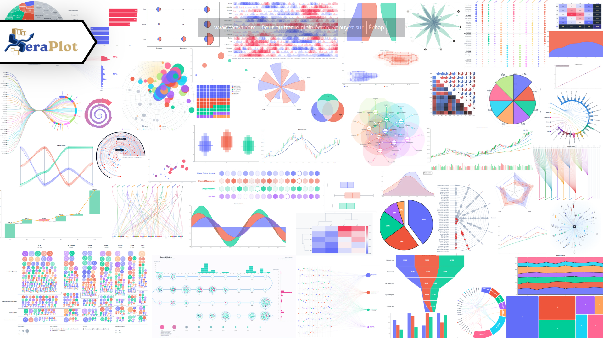

# SeraPlot

Rust-native data visualization, compiled straight to a native library and called
through .NET's own P/Invoke. One hop: your C# code calls into `seraplot.dll`
directly, the same binary a C++ or a browser build links against. No interpreter,
no bridge, nothing in between.



60+ chart families, 400+ named variants, discovered live from the engine's own
registry -- never a hand-maintained list drifting out of sync with what the
engine can actually do.

## Install

```
dotnet add package SeraPlot
```

Targets `net7.0` through `net10.0`. Ships the `win-x64` native asset inside the
package -- nothing else to install.

## Build a chart

```csharp
using SeraPlot;

var chart = Api.Call("Bar", """{"title":"Q1-Q4","labels":["Q1","Q2","Q3","Q4"],"values":[24,38,17,42]}""");
chart.Save("bar.html");
```

`Api.Call` takes a chart family name and a JSON payload, and returns a `Chart` --
an HTML/SVG document you can save, print, or hand to a browser control. Family
names are PascalCase (`Bar`, `BuildBar`, `Sankey`, `Heatmap`, ...) generated at
runtime from the engine's live name list, so a family the engine adds tomorrow
is callable today without a package update.

## Chain styling calls

Every chart carries its own set of ~460 chainable methods -- grid lines, axis
visibility, backgrounds, annotations, themes -- resolved the same way:

```csharp
var chart = Api.Call("Bar", json)
    .Call("GridX")
    .Call("NoHover")
    .Call("SetBg", """{"color":"#111"}""");
```

`Chart` keeps its native handle alive across the whole chain -- a five-call
chain on a large chart costs one round-trip in, one out, not five of each.
`Chart` implements `IDisposable`; wrap it in `using` for anything long-lived.

## Find out what's available

Nothing here is hand-typed into this package -- every name below comes straight
from the engine at runtime:

```csharp
Api.List();                 // every chart/utility function name
Api.Names;                  // PascalCase name -> canonical name, e.g. "Bar" -> "build_bar"
Api.ChartVariants();        // every family and its named variants, as JSON
Api.ChartMethods();         // every chainable styling method name
Api.Params("bar");          // accepted keyword arguments for a family
Api.ChartThemes();
Api.Scenes3d();
Api.Docs();
```

## Aliases

Give any family a short name of your own, shared across every language SeraPlot
ships bindings for:

```csharp
Api.AliasAdd("build_bar", "b");
Api.Call("b", json);        // resolves to build_bar
Api.AliasList();
Api.AliasSave();            // persists to disk, picked up automatically next run
```

## Why native

The engine behind these charts is the same one benchmarked at two to three
orders of magnitude faster than typical interpreted or browser-rendered
charting stacks on large series -- because it never leaves compiled code to
do it. This package doesn't add a layer on top of that; it's the same
compiled engine, called directly.

- Source and issue tracker: https://github.com/feur25/Sera
- Docs and chart catalog: https://feur25.github.io/Sera/
